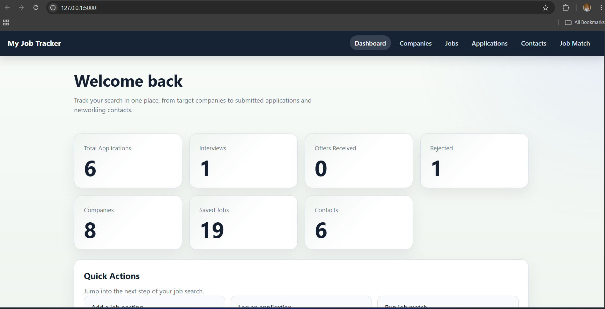

# Job Application Tracker

A Flask + MySQL web app for tracking a job search from one place. The project helps manage companies, saved jobs, submitted applications, recruiter and networking contacts, and skill-to-job matches.

## Features

- Dashboard with application, company, job, and contact metrics
- Full CRUD support for companies, jobs, applications, and contacts
- Interview notes saved in the application data
- Job match page that compares your skills against saved job requirements and shows a match percentage
- Delete confirmations for destructive actions
- Delete safeguards for companies with related jobs or contacts
- Delete safeguards for jobs with linked applications

## Tech Stack

- Python
- Flask
- MySQL
- HTML templates
- CSS

## Prerequisites

- Python 3 with `pip`
- A local MySQL server
- The `mysql` command-line client for importing `schema.sql`

## Project Structure

The course project files live in `job_tracker/` and follow the structure shown in the project docx.

```text
job_tracker/
├── app.py
├── database.py
├── templates/
│   ├── base.html
│   ├── dashboard.html
│   ├── companies.html
│   ├── jobs.html
│   ├── applications.html
│   ├── contacts.html
│   └── job_match.html
├── static/
│   └── style.css
├── schema.sql
├── AI_USAGE.md
├── README.md
└── requirements.txt
```

`job_tracker/config.py` is a local machine configuration file created during setup. It is intentionally ignored by Git, so it is not listed as part of the submitted project structure.

## Quick Start

Run these steps from the repository root unless noted otherwise.

1. Create and activate a virtual environment.
2. Install dependencies:

   ```bash
   pip install -r requirements.txt
   ```

   The root `requirements.txt` delegates to `job_tracker/requirements.txt`, which remains the app-level source of truth.

3. Create the database:

   ```sql
   CREATE DATABASE job_tracker;
   ```

4. Import the schema and sample data:

   ```bash
   mysql -u root -p job_tracker < job_tracker/schema.sql
   ```

   If you already imported an older dump, recreate the database so the current schema and field names match the app.

5. Create a local database config file:

   ```bash
   cp job_tracker/config.example.py job_tracker/config.py
   ```

6. Edit `job_tracker/config.py` and set your MySQL credentials.

   ```python
   DB_HOST = '127.0.0.1'
   DB_USER = 'root'
   DB_PASSWORD = 'your_password_here'
   DB_NAME = 'job_tracker'
   DB_PORT = 3306
   ```

   `job_tracker/config.py` is ignored by Git so your real password is not committed. For class submission, share the password separately in Canvas as requested by your instructor.

7. Start the app:

   ```bash
   python3 job_tracker/app.py
   ```

8. Open `http://127.0.0.1:5000` in your browser.

## Notes

- `job_tracker/README.md` contains the in-project setup guide.
- `requirements.txt` at the repo root is provided only as a convenience wrapper for installing from the top level.
- `job_tracker/AI_USAGE.md` documents how AI tools were used during development.
- `job_tracker/schema.sql` is the MySQL dump with populated sample records used by the app.

## Demo Asset

## Screenshots

### Dashboard


### Applications


### Companies


### Contacts


### Job Matching


https://github.com/user-attachments/assets/43ad0a95-3a2a-4b4e-a669-f741f69a6589


