# Job Application Tracker

A web-based job search management application built with **Python, Flask, and MySQL**. It helps users organize job applications, target companies, saved job postings, networking contacts, and skill-to-job matches in one place.

## Features

- **Dashboard:** View application, interview, offer, rejection, company, job, and contact statistics.
- **Company Management:** Add, edit, view, and delete companies.
- **Job Management:** Save and manage job postings linked to companies.
- **Application Tracking:** Track applications through different recruitment stages.
- **Contact Management:** Organize networking contacts associated with companies.
- **Skill Matching:** Compare your skills with the requirements of saved jobs.
- **Data Validation:** Prevent deletion of companies or jobs that still have linked records.
- **Delete Confirmation:** Confirm destructive actions before proceeding.

## Tech Stack

- **Backend:** Python, Flask
- **Database:** MySQL
- **Frontend:** HTML, CSS, Jinja2 templates
- **Tools:** Git, GitHub, PyCharm

## Project Structure

```text
job-application-tracker/
├── job_tracker/
│   ├── app.py
│   ├── database.py
│   ├── config.example.py
│   ├── schema.sql
│   ├── templates/
│   └── static/
├── requirements.txt
└── README.md
```

A local `config.py` file is created during setup and excluded from Git to help protect database credentials.

## Prerequisites

Before running the project, install:

- Python 3
- MySQL Server
- Git (optional, for cloning the repository)

## Installation and Setup

### 1. Clone the repository

```bash
git clone https://github.com/sachinyadav71428-lgtm/job-application-tracker.git
cd job-application-tracker
```

### 2. Create a virtual environment

On Windows:

```powershell
python -m venv .venv
```

Activate it in the PyCharm terminal:

```powershell
.\.venv\Scripts\Activate.ps1
```

If PowerShell blocks script execution, use Command Prompt instead:

```cmd
.venv\Scripts\activate.bat
```

### 3. Install dependencies

From the repository root, run:

```bash
python -m pip install -r requirements.txt
```

### 4. Create the database

Open MySQL Workbench or your MySQL command-line client and execute:

```sql
CREATE DATABASE job_tracker;
```

### 5. Import the database schema

Open the `job_tracker` directory in your terminal.

Import the provided SQL file into the database. With the MySQL command-line client in Windows Command Prompt, run:

```cmd
mysql -u root -p job_tracker < schema.sql
```

Enter your MySQL password when prompted.

The SQL file includes the project's database structure and sample records. Review the file before importing it into any database containing important data.

### 6. Configure the database connection

From the `job_tracker` directory, create your local configuration file:

```powershell
Copy-Item config.example.py config.py
```

Open `config.py` and enter your own local MySQL connection details using the variable names already defined in `config.example.py`.

**Security note:** Never commit your real database password or other secrets to GitHub.

### 7. Run the application

From the `job_tracker` directory, run:

```bash
python app.py
```

### 8. Open the application

Visit:

http://127.0.0.1:5000/

## Main Pages

| Route | Description |
|---|---|
| `/` | Dashboard and statistics |
| `/companies` | Company directory |
| `/jobs` | Saved job postings |
| `/applications` | Job application tracker |
| `/contacts` | Networking contact manager |
| `/job_match` | Skill-to-job matching |

## Database Relationships

- A job belongs to a company.
- An application belongs to a job.
- A contact belongs to a company.
- Job requirements are stored as JSON.
- Interview information is stored in the application's interview data field.

## Future Improvements

- User registration and authentication
- Search, filtering, and sorting
- Application deadline reminders
- Data visualization and progress charts
- Deployment to a cloud hosting platform

## Author

**Sachin Kumar Yadav**

GitHub: [sachinyadav71428-lgtm](https://github.com/sachinyadav71428-lgtm)

## Screenshots

### Dashboard


### Applications
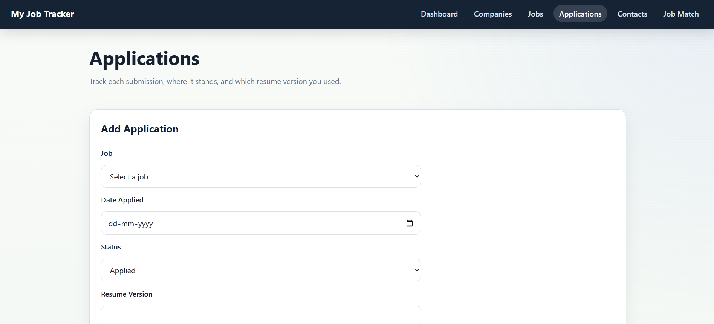

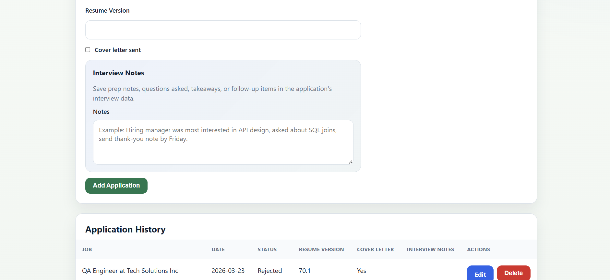

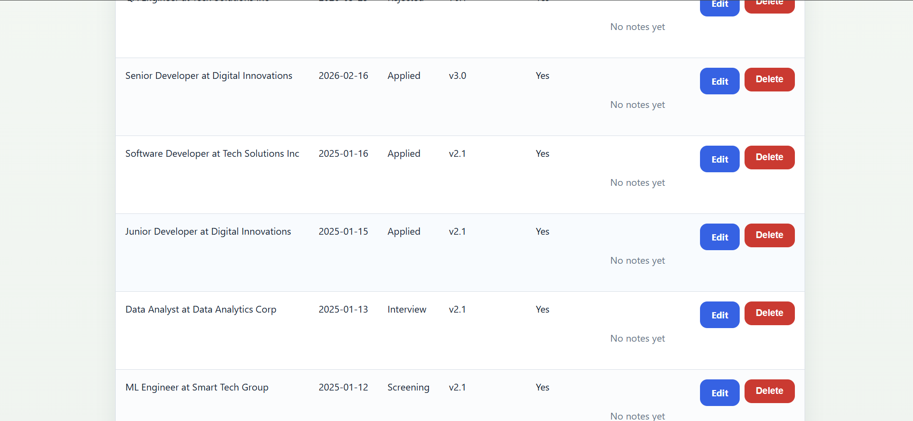

### Companies
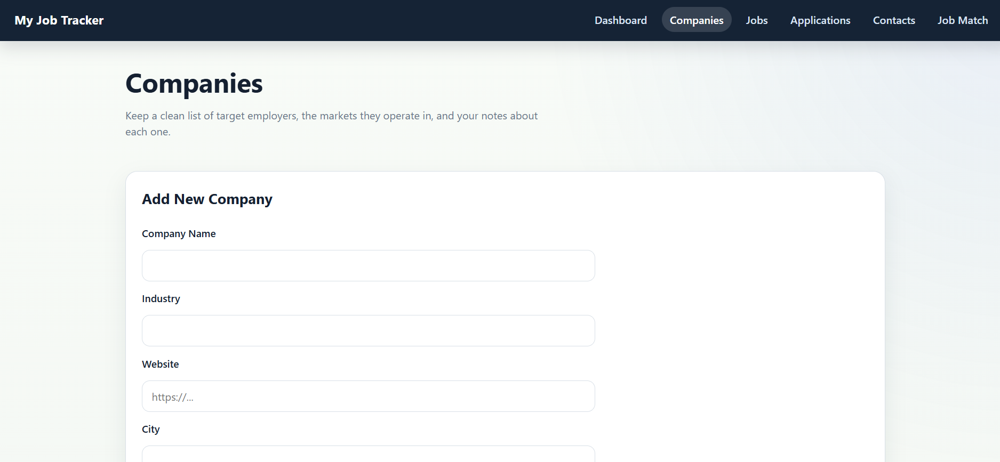

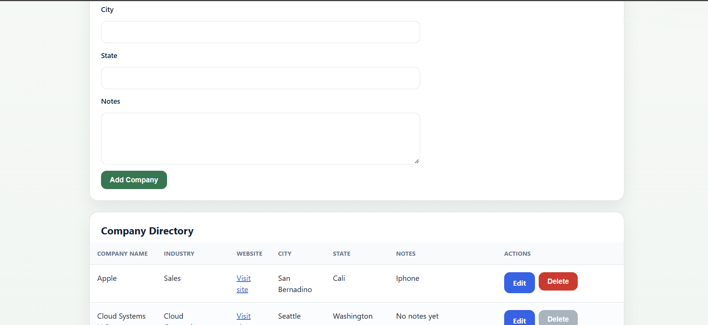

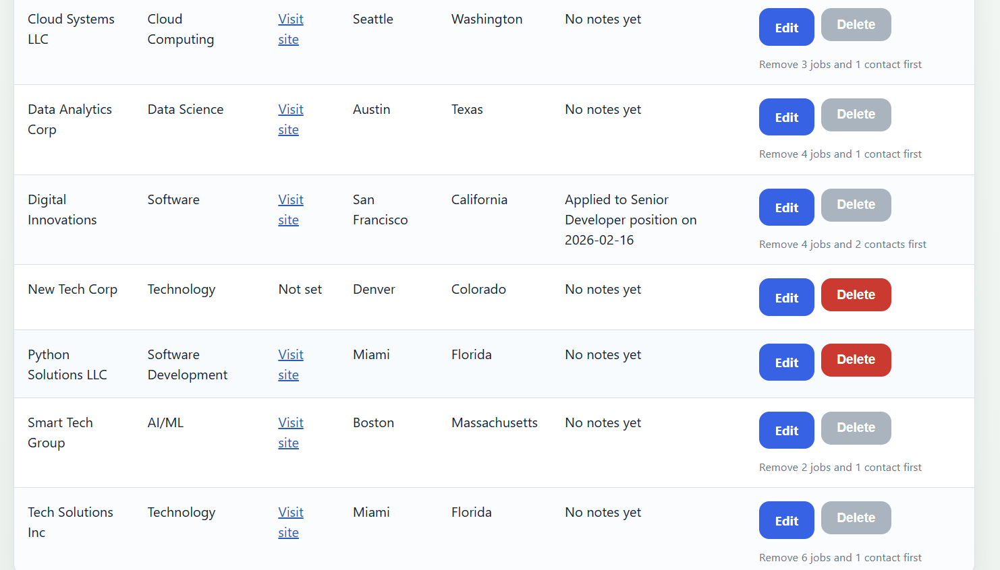

### Contacts
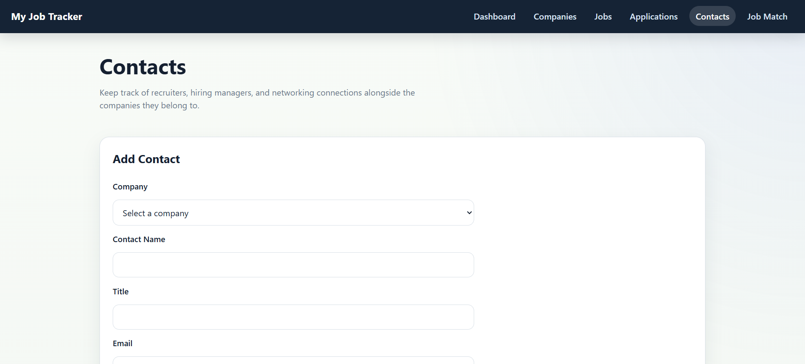

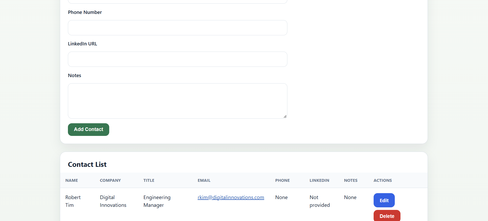

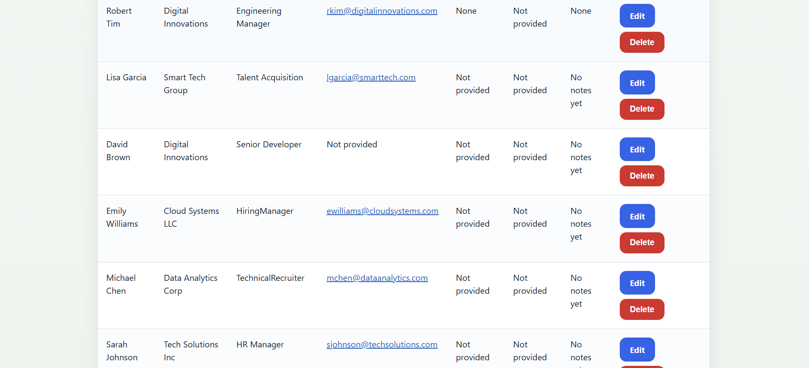

### Job Matching
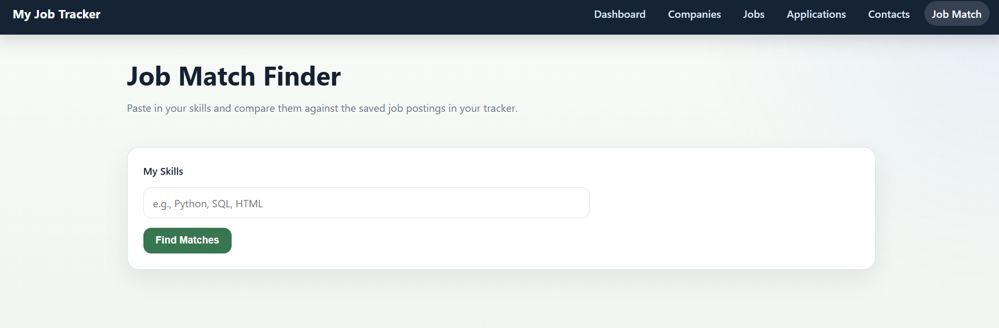

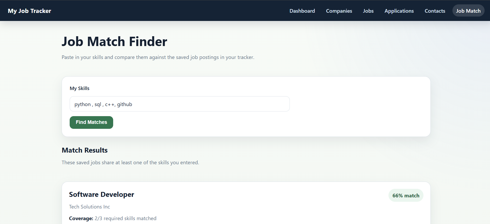

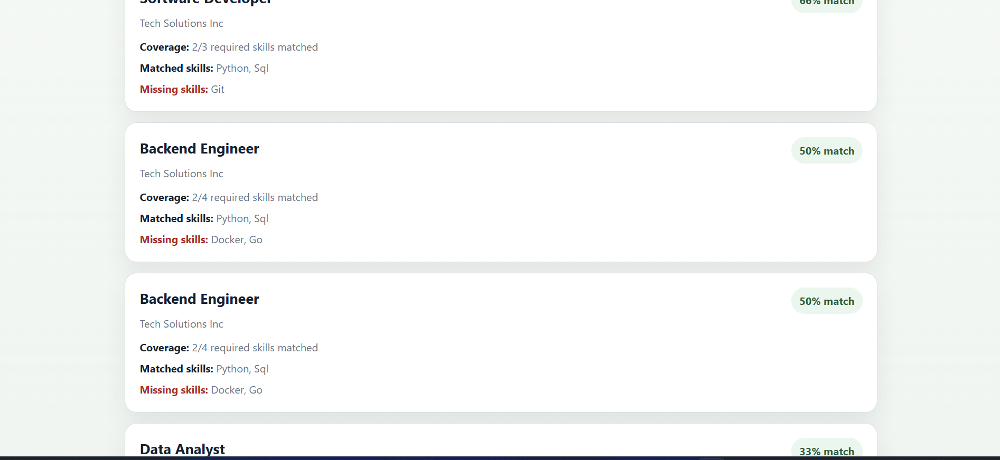
---

This project was developed as a practical application of Python web development, database management, and CRUD operations.
